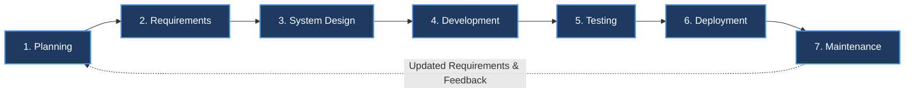

# 7 Stages of SDLC (Software Development Life Cycle) — SAD

> 📌 **Class Notes Reference**: Based on handwritten lecture notes from [`stages.md.jpeg`](file:///d:/Sad_Theory_01/stages.md.jpeg).

---

## 1. Overview: The 7-Stage SDLC Model

The **7 Stages of SDLC** outlines the practical lifecycle of engineering software from initial ideation and feasibility evaluation to long-term operational maintenance and continuous requirement updates.

---

## 2. Detailed Breakdown of the 7 Stages

### 1️⃣ Planning
The foundational stage focused on defining the project direction, viability, resource constraints, and potential risks before committing significant engineering resources.

* **Key Elements from Lecture Notes**:
  * **Project Scope**: Defining project boundaries, deliverables, and high-level milestones.
  * **Feasibility Study**: Evaluating economic, technical, operational, and schedule feasibility.
  * **Resource Allocation**: Identifying and assigning human resources, hardware, tools, and budget.
  * **Project Planning**: Creating work breakdown structures (WBS), schedules, and sprint timelines.
  * **Risk Assessment**: Identifying technical, financial, and operational risks early and planning mitigations.
* **Key Deliverables**: Project Charter, Feasibility Report, Resource Plan, Risk Management Matrix.

---

### 2️⃣ Requirements
The elicitation and formalization stage where engineers and business analysts translate stakeholder needs into precise, unambiguous technical specifications.

* **Key Elements from Lecture Notes**:
  * **Gather Requirements**: Conducting interviews, stakeholder surveys, workshops, and reviewing business context.
  * **Scoping**: Narrowing down system boundary—determining in-scope vs. out-of-scope features.
  * **Analysis**: Evaluating collected user needs for consistency, dependencies, and conflicts.
  * **Specification**: Documenting requirements into clear, verifiable functional and non-functional requirements.
  * **Visualize Workflows**: Creating context diagrams, user journey flows, and process activity diagrams.
* **Key Deliverables**: Business Requirements Document (BRD), Software Requirements Specification (SRS), Workflow Diagrams.

---

### 3️⃣ System Design
Translating formalized requirements into technical blueprints, schemas, wireframes, and architectural decisions.

* **Key Elements from Lecture Notes**:
  * **User Interface (UI) Design**: Wireframes, mockups, design systems, and user navigation layouts.
  * **UML Design**: Use case diagrams, sequence diagrams, class diagrams, and activity models.
  * **Database Design**: Entity-Relationship Diagrams (ERD), table schemas, data normalization, and indexing strategies.
  * **Address Cybersecurity Concerns**: Implementing authentication (OAuth/JWT), role-based access control (RBAC), data encryption (in-transit & at-rest), and threat modeling.
  * **Prototyping**: Developing interactive clickable prototypes or Proofs of Concept (PoC) for validation.
  * **SRS (Software Requirements Specification)**: Finalizing the detailed architectural and technical SRS baseline.
* **Key Deliverables**: System Design Document (SDD), ERD / Database Schema, UI/UX Prototypes, UML Diagrams, Security Architecture Plan.

---

### 4️⃣ Development
The implementation stage where architectural designs are converted into clean, maintainable, and executable source code.

* **Key Elements from Lecture Notes**:
  * **Coding and Implementation**: Writing modular, standards-compliant source code across frontend, backend, and database layers.
  * **Version Control (Git)**: Branching models (e.g., Git Flow, feature branches), peer code reviews, and commit standards.
  * **System Integration**: Connecting microservices, APIs, external third-party services, and internal subsystems.
  * **Automated Pipelines**: Continuous Integration and Continuous Deployment (CI/CD) pipelines for linting, building, and automated checks.
  * **Quality Assurance (Developer-Level)**: Writing unit tests, static code analysis, and refactoring to meet code health benchmarks.
* **Key Deliverables**: Source Code Repository, Build Artifacts, Automated CI/CD Scripts, Unit Test Coverage Reports.

---

### 5️⃣ Testing
Rigorous verification and validation to detect bugs, verify performance, and ensure software matches business specifications before release.

* **Key Elements from Lecture Notes**:
  * **Unit Testing**: Testing individual components, functions, or methods in isolation.
  * **Integration Testing**: Verifying data communication and contracts between integrated modules and APIs.
  * **System Testing**: End-to-end evaluation of the complete, unified application against technical specifications.
  * **User Testing (UAT)**: Business users and end customers test the system in staging to validate real-world user workflows and readiness.
* **Key Deliverables**: Test Plan, Test Cases, Defect / Bug Tracking Reports, UAT Sign-off Certificate.

---

### 6️⃣ Deployment
The transition of verified code into the production environment for real customer usage.

* **Key Elements from Lecture Notes**:
  * **Environment Setup**: Configuring production servers, cloud hosting, container orchestration (e.g., Docker, Kubernetes), CDN, and production databases.
  * **Safe Deployment**: Utilizing zero-downtime deployment strategies (blue-green deployments, canary releases, or rolling updates) with rollback plans.
  * **Gradual Availability**: Rolling out features in cohorts or phases to mitigate blast radius and monitor server telemetry under live traffic.
  * **User Onboarding**: Providing documentation, user manuals, training sessions, and account provisioning for smooth adoption.
* **Key Deliverables**: Live Production System, Production Deployment Runbook, Release Notes, User Onboarding Guides.

---

### 7️⃣ Maintenance
The longest and most critical operational phase ensuring continuous system reliability, user satisfaction, and business adaptability.

* **Key Elements from Lecture Notes**:
  * **Bug / Issues**: Diagnosing, triaging, and patching errors uncovered in live production.
  * **Troubleshooting**: Root cause analysis (RCA), monitoring logs, latency spikes, and uptime tracking.
  * **Receive Feedback from the Users**: Collecting customer feedback, helpdesk tickets, and analytics to uncover pain points.
  * **Delivers List of Updated Requirements**: Feeding identified enhancements, new features, and regulatory changes back into the next development cycle.
* **Key Deliverables**: Incident Logs & Postmortems, SLA Uptime Reports, Patch Releases, Change Request / Updated Requirements List.

---

## 3. Quick Reference Matrix (Lecture Notes Summary)

| Stage # | Stage Name | Handwritten Lecture Focus Points | Primary Deliverable |
| :---: | :--- | :--- | :--- |
| **1** | **Planning** | Project Scope, Feasibility Study, Resource Allocation, Project Planning, Risk Assessment | Project Charter & Feasibility Report |
| **2** | **Requirements** | Gather Requirements, Scoping, Analysis, Specification, Visualize Workflows | SRS & Workflow Diagrams |
| **3** | **System Design** | UI Design, UML Design, Database Design, Cybersecurity Concerns, Prototyping, SRS | SDD, ERD, Prototypes |
| **4** | **Development** | Coding, Git Version Control, System Integration, Automated Pipelines, Quality Assurance | Tested Source Code & Builds |
| **5** | **Testing** | Unit Testing, Integration Testing, System Testing, User Testing | Test Reports & UAT Sign-off |
| **6** | **Deployment** | Environment Setup, Safe Deployment, Gradual Availability, User Onboarding | Live Production System |
| **7** | **Maintenance** | Bug/Issues, Troubleshooting, User Feedback, Delivers List of Updated Requirements | Patch Updates & Updated Requirements |

---

## 4. Key Takeaways for SAD Exam

1. **Cycle Nature**: Maintenance does not end the system life; it delivers an *updated list of requirements*, restarting the cycle for the next release or phase.
2. **Security Early**: Cybersecurity is addressed in the **Design** stage (Security by Design), not as an afterthought during deployment.
3. **Automated Pipelines**: Modern SDLC integrates automated pipelines (CI/CD) and Git version control directly within the **Development** stage to enforce continuous quality assurance.
