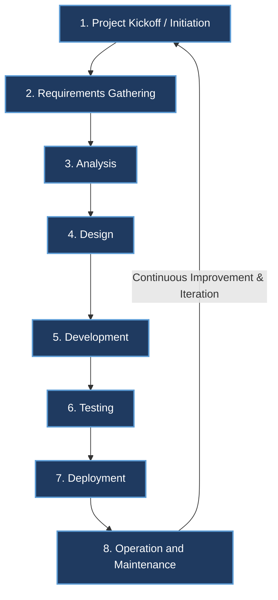

# Software Development Life Cycle (SDLC) — System Analysis and Design (SAD)

> 📌 **Reference Diagram**: Based on [`SDLC.md.png`](file:///d:/Sad_Theory_01/SDLC.md.png).

---

## 1. What is SDLC?

The **Software Development Life Cycle (SDLC)** is a structured, step-by-step process followed by software development teams to plan, design, build, test, deploy, and maintain high-quality software systems.

The primary goals of SDLC are:
* Delivering software that meets or exceeds customer requirements and expectations.
* Completing projects within scheduled timelines and allocated budgets.
* Ensuring software quality, maintainability, scalability, and security throughout its lifespan.

---

## 2. SDLC Phases (Life Cycle Flow)

As illustrated in the diagram, SDLC operates as a continuous, iterative cycle consisting of **8 core phases**:

---

## 3. Detailed Breakdown of the 8 SDLC Phases

### 1️⃣ Project Kickoff / Initiation
* **Objective**: Establish the foundation, scope, and feasibility of the proposed system.
* **Key Activities**:
  * Identify business needs and project objectives.
  * Conduct feasibility studies (Economic, Technical, Operational, Legal, and Schedule feasibility).
  * Identify key stakeholders and assign project team members.
  * Formulate project baseline, timeline, and high-level budget.
* **Key Deliverables**:
  * **Project Charter**
  * **Feasibility Study Report**
  * **Project Initiation Document (PID)**

---

### 2️⃣ Requirements Gathering
* **Objective**: Collect, elicit, and understand detailed business and user expectations.
* **Key Activities**:
  * Conduct stakeholder interviews, surveys, workshops, and observation sessions.
  * Gather functional requirements (what the system should do) and non-functional requirements (performance, security, usability).
  * Review existing systems, workflows, and documentation.
* **Key Deliverables**:
  * **Business Requirements Document (BRD)**
  * **User Stories / Use Cases**
  * **Initial Requirements Traceability Matrix (RTM)**

---

### 3️⃣ Analysis
* **Objective**: Examine gathered requirements in depth to ensure completeness, feasibility, and clarity.
* **Key Activities**:
  * Resolve conflicts, ambiguities, and missing elements in requirements.
  * Model existing and proposed business logic (e.g., Data Flow Diagrams - DFD, Context Diagrams).
  * Define system boundaries, inputs, processes, and outputs.
  * Formulate formal system specifications.
* **Key Deliverables**:
  * **Software Requirements Specification (SRS)**
  * **Process Flow Diagrams & Data Flow Models**

---

### 4️⃣ Design
* **Objective**: Transform analyzed requirements into architectural and technical blueprints.
* **Key Activities**:
  * **High-Level Design (HLD)**: System architecture, tech stack selection, database schema (ERD), networking, and integration points.
  * **Low-Level Design (LLD)**: Module specifications, interface design, API contracts, class diagrams, algorithm pseudo-code.
  * **UI/UX Design**: Wireframes, prototypes, user journeys, and component styling.
* **Key Deliverables**:
  * **System Design Document (SDD)**
  * **Entity Relationship Diagram (ERD) & Database Schema**
  * **UI/UX Prototypes & Wireframes**
  * **API / Interface Specifications**

---

### 5️⃣ Development (Implementation / Coding)
* **Objective**: Convert design specifications into actual executable source code.
* **Key Activities**:
  * Developers write modular, well-documented code adhering to coding standards and guidelines.
  * Database creation and implementation of stored procedures, queries, and migrations.
  * Version control management (Git branching, merging, and pull request reviews).
  * Unit testing by developers to verify individual functions and modules.
* **Key Deliverables**:
  * **Source Code Repository**
  * **Working Software Builds / Increments**
  * **Unit Test Suites**

---

### 6️⃣ Testing (Verification & Validation)
* **Objective**: Ensure the software is bug-free, secure, reliable, and meets all SRS requirements.
* **Key Activities**:
  * **Integration Testing**: Verify interaction between connected modules and services.
  * **System Testing**: Validate complete, integrated system end-to-end.
  * **Performance & Security Testing**: Load, stress, and vulnerability testing.
  * **User Acceptance Testing (UAT)**: Business users validate system against practical business workflows.
* **Key Deliverables**:
  * **Test Plan & Test Cases**
  * **Bug Reports & Defect Tracking Logs**
  * **UAT Sign-off Report**

---

### 7️⃣ Deployment (Release / Implementation)
* **Objective**: Release the tested software application into the production environment for active user access.
* **Key Activities**:
  * Prepare production infrastructure (cloud hosting, servers, databases, networking, CI/CD pipelines).
  * Execute deployment strategy (e.g., Big Bang, Phased, Parallel, or Canary rollout).
  * Perform data migration from legacy systems if applicable.
  * End-user and administrative training, along with system handover.
* **Key Deliverables**:
  * **Production Release Build**
  * **Deployment Guide / Runbook**
  * **User Manuals & Training Materials**

---

### 8️⃣ Operation and Maintenance
* **Objective**: Ensure the system operates smoothly, securely, and continuously evolves with business needs.
* **Key Activities**:
  * 24/7 system monitoring, performance tuning, and backup management.
  * Bug fixes and hotpatches for defects found in live production (**Corrective Maintenance**).
  * Enhancing system features to match changing business or regulatory environments (**Adaptive Maintenance**).
  * Improving system performance, maintainability, and code quality (**Perfective Maintenance**).
  * Routine preventive checks and security patching (**Preventive Maintenance**).
* **Key Deliverables**:
  * **Maintenance & Incident Logs**
  * **SLA Reports**
  * **Change Requests (feeding into future project cycles)**

---

## 4. Phase Summary & Deliverables Matrix

| # | Phase Name | Primary Focus | Key Deliverables | Main Roles Involved |
| :-: | :--- | :--- | :--- | :--- |
| **1** | **Project Kickoff / Initiation** | Scope & Feasibility | Project Charter, Feasibility Report | Project Manager, Sponsors, Lead Analyst |
| **2** | **Requirements Gathering** | Business & User Needs | BRD, User Stories, Initial RTM | Business Analyst, Stakeholders, End Users |
| **3** | **Analysis** | Model & Formalize Specs | SRS Document, Process/Data Flow Models | Systems Analyst, Product Owner |
| **4** | **Design** | Architectural & UI Blueprint | SDD, ERD, Wireframes, API Specs | System Architect, UI/UX Designer, DB Admin |
| **5** | **Development** | Writing Executable Code | Source Code, Unit Tests, Build Artifacts | Software Developers, Full-stack Engineers |
| **6** | **Testing** | Quality & Bug Elimination | Test Cases, Bug Reports, UAT Sign-off | QA Engineers, Testers, UAT Users |
| **7** | **Deployment** | Production Release | Live System, Release Runbook, User Manual | DevOps Engineers, SysAdmins, Release Manager |
| **8** | **Operation & Maintenance** | Monitoring & Continuous Support | Incident Logs, SLA Reports, Patch Updates | Support Engineers, DevOps, Site Reliability Engineers |

---

## 5. Four Types of Software Maintenance (SAD Exam Focus)

1. **Corrective Maintenance**: Fixing errors or bugs discovered during day-to-day operation.
2. **Adaptive Maintenance**: Modifying software to adapt to changes in hardware, OS, or third-party APIs.
3. **Perfective Maintenance**: Enhancing existing functions, boosting speed, or optimizing resource consumption based on user feedback.
4. **Preventive Maintenance**: Anticipating future issues through code refactoring, security audits, and preventive routine updates.

---

## ⚡ Quick Flashcard Summary
* **What is SDLC?** A standardized cycle of phases for planning, designing, developing, testing, deploying, and maintaining software.
* **8 Phases in Order**:
  1. Kickoff $\rightarrow$ 2. Requirements $\rightarrow$ 3. Analysis $\rightarrow$ 4. Design $\rightarrow$ 5. Development $\rightarrow$ 6. Testing $\rightarrow$ 7. Deployment $\rightarrow$ 8. Operation & Maintenance.
* **Key Exam Rule**: *Maintenance is the longest and costliest phase of SDLC.*
