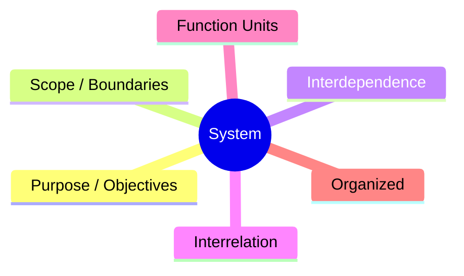

# What is a System? — System Analysis and Design (SAD)

> 📌 **Class Notes Reference**: Based on lecture notes and concepts from [`system.md.jpeg`](file:///d:/Sad_Theory_01/system.md.jpeg).

---

## 1. What is a System?

A **System** is an organized collection of functioning units (subsystems/parts) that are interrelated and interdependent, operating within defined boundaries to achieve a common purpose or set of objectives.



> ⚠️ **Golden Rule / Core Principle**:
> **Central goal gets priority over sub/unit goals.** *(Subsystems must align with and support the global system objective rather than pursuing conflicting local goals).*

---

## 2. Key Factors of a System (Handwritten Lecture Breakdown)

| Factor | Description & Meaning |
| :--- | :--- |
| **Components (Subsystems / Part)** | The individual building blocks, modules, or functional units that make up the whole system. |
| **Interrelationships** | How components connect, communicate, and interface with each other. |
| **Boundary** | The dividing perimeter defining **what is inside vs. outside** of the system (defining system scope). |
| **Inputs $\rightarrow$ Processes $\rightarrow$ Output** | **Inputs**: Data, resources, or raw items entering the system.<br>**Processes**: Transformation activities and business logic.<br>**Outputs**: Delivered results, reports, or finished products. |
| **Goal / Purpose** | The primary business or operational objective that justifies why the system exists. |
| **Feedback / Control / Behavior-Monitor** | Monitoring mechanisms that observe system behavior, measure output quality, and trigger corrective controls. |
| **Environment** | External factors outside the boundary (e.g., users, vendors, market trends, laws) that influence the system. |

---

## 3. Basic System Cycle & Flow

```
                  ┌──────────────────────────────────────────┐
                  │               Environment                │
                  │         (External Factors Influence)     │
                  │                                          │
                  │     ┌──────────────────────────────┐     │
  ┌───────────┐   │     │        System Boundary       │     │   ┌────────────┐
  │   Input   │───┼────>│  ┌────────────────────────┐  │─────┼──>│   Output   │
  │ (Data/Raw)│   │     │  │       Processes        │  │     │   │ (Processed)│
  └───────────┘   │     │  │    (Transformation)    │  │     │   └────────────┘
                  │     │  └────────────────────────┘  │     │
                  │     │               │              │     │
                  │     │               ▼              │     │
                  │     │  ┌────────────────────────┐  │     │
                  │     │  │Feedback/Control/Monitor│  │     │
                  │     │  └────────────────────────┘  │     │
                  │     └──────────────────────────────┘     │
                  └──────────────────────────────────────────┘
```

---

## 4. Key System Characteristics for SAD Exams

1. **Organization**: Orderly structure where units are arranged systematically, not randomly.
2. **Interaction**: Dynamic exchanges and handoffs between units via defined interfaces.
3. **Interdependence**: A unit's operation depends on other units; outputs of one are inputs to another.
4. **Integration**: Synthesis of subsystems working as a unified whole towards the central objective.
5. **Central Objective**: The guiding star for system requirements and feasibility evaluations.

---

## ⚡ Quick Flashcard Summary
* **What is a System?** Organized, interrelated, and interdependent functional units working within a boundary to fulfill a purpose.
* **Exam Rule**: *Central goal gets priority over sub/unit goals.*
* **7 Key Factors**: Components, Interrelationships, Boundary, Inputs $\rightarrow$ Processes $\rightarrow$ Output, Goal/Purpose, Feedback/Control/Behavior-Monitor, Environment.
